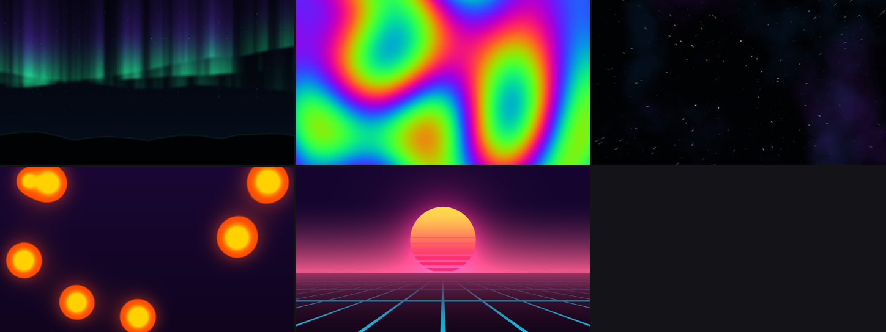

# rusty-wallpaper

Animated desktop wallpapers for **Windows**, written in Rust. The scenes are
rendered on the CPU, so it works without any GPU drivers or graphics API.
Linux (X11) also works.



*aurora, plasma, starfield, lava, synthwave (plus `image` for your own pictures)*

## Features

- **Lives behind your desktop icons.** On Windows it uses the `WorkerW` technique
  (handles both the classic layout and the Windows 11 24H2+ layout). On X11 it
  uses an EWMH `_NET_WM_WINDOW_TYPE_DESKTOP` window.
- **Multi-monitor.** Draws on every monitor by default, or on a single one.
- **Easy on resources.**
  - Pauses on any monitor where a fullscreen or maximized app is in front
    (games, videos, a maximized browser).
  - Has a frame-rate cap.
  - Renders at a lower internal resolution and smoothly upscales.
  - Rendering is spread across all cores with rayon.
- **Live config.** Edit `config.toml` and the change appears within a second.
  A broken edit is logged and ignored.
- **Image slideshows** with crossfades and a slow Ken Burns zoom/pan.
- **Background mode, `stop`, and autostart at login** on Windows.
- Puts your normal wallpaper back when it exits.

## Quick start (Windows)

```powershell
cargo build --release
.\target\release\rusty-wallpaper.exe --windowed          # preview in a window (Esc quits, Space pauses)
.\target\release\rusty-wallpaper.exe                     # put it on the desktop (Ctrl+C to quit)
```

Run it in the background and start it at login:

```powershell
rusty-wallpaper init                     # writes %APPDATA%\rusty-wallpaper\config.toml
rusty-wallpaper --background             # detaches from the console
rusty-wallpaper stop                     # asks the background instance to quit
rusty-wallpaper autostart on             # start at login (HKCU\...\CurrentVersion\Run)
rusty-wallpaper autostart off
```

Only one desktop instance runs at a time. In background mode, logs go to
`%LOCALAPPDATA%\rusty-wallpaper\rusty-wallpaper.log`.

CI builds a ready-made `rusty-wallpaper.exe` on every push. Download it from
the **rusty-wallpaper-windows-x64** artifact of the latest *CI* workflow run.

## Commands

| Command | What it does |
| --- | --- |
| `rusty-wallpaper [run] [-s SCENE] [-c CONFIG] [--fps N] [-w] [--background]` | Show the wallpaper (the default command) |
| `rusty-wallpaper list` | List the built-in scenes |
| `rusty-wallpaper monitors` | List monitors and their indices |
| `rusty-wallpaper render OUT.png [-s SCENE] [--width W --height H] [-t SECONDS]` | Render one frame to a PNG |
| `rusty-wallpaper init [--force]` | Write the example config |
| `rusty-wallpaper stop` | Stop the running instance (Windows) |
| `rusty-wallpaper autostart on\|off [-c CONFIG]` | Toggle start at login (Windows) |

## Configuration

The config file lives at `%APPDATA%\rusty-wallpaper\config.toml` on Windows and
`~/.config/rusty-wallpaper/config.toml` on Linux. Every setting is optional.
[`examples/config.toml`](examples/config.toml) documents all of them:

```toml
scene = "image"
fps = 30
render_scale = 0.5          # fraction of screen resolution to render at
pause_when_covered = true

[scenes.image]
path = "~/Pictures/Wallpapers"   # a file or a folder
interval = 60.0
fade = 2.0
zoom = 0.08
```

Each scene reads its parameters (speeds, colors as `"#rrggbb"`, counts) from
its own `[scenes.<name>]` table.

## Performance

These are frame times at the default settings: a 1080p screen at
`render_scale = 0.5`, measured on a 4-core cloud VM.

| scene | ms/frame |
| --- | --- |
| aurora | ~7 |
| plasma | ~8 |
| lava | ~4 |
| synthwave | ~4 |
| starfield | ~1.5 |

At 30 fps that is a small fraction of one core. Nothing is rendered while a
monitor is covered.

## Writing a scene

Implement the `Scene` trait in `src/scene/` and add it to `SCENES` in
`src/scene/mod.rs`:

```rust
impl Scene for MyScene {
    fn render(&mut self, frame: &mut Frame, ctx: &FrameCtx) {
        let t = ctx.time;
        frame.par_shade_uv(|u, v| pack(u, v, 0.5 + 0.5 * t.sin()));
    }
}
```

`Frame::par_shade` works like a fragment shader that runs on every core.
`render::math` has GLSL-style helpers: `mix`, `smoothstep`, `fract`, value
`noise`, `fbm`, and the cosine `palette`. A simple scene can draw itself
directly with `Frame::splat`, as the starfield does.

## Platform notes

- **Windows 10/11.** Supported. Like every WorkerW-based wallpaper tool, it
  needs Explorer running. If Explorer restarts, restart the wallpaper too.
- **Linux, X11.** Supported. The window manager needs to honor desktop-type
  windows; most do.
- **Linux, Wayland.** There is no portable "behind the desktop" layer, so it
  falls back to a fullscreen window kept at the bottom. Running it under
  XWayland (`WINIT_UNIX_BACKEND=x11`) may work better.
- **macOS.** Borderless bottom-level window only. Untested.
